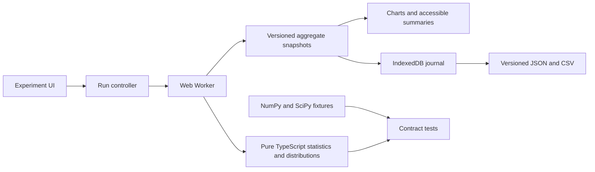

# STATUM LAB architecture proposal

Discovery will validate the browser-only design against representative hardware and course needs. An application shell and four experiment features share the same execution and math contracts.

## Module responsibilities

| Module | Contract and location |
| --- | --- |
| Statistical core | `web/src/core/{statistics,distributions,random}/`. Pure numerical functions, parameter validation, explicit domain errors and a versioned seeded PRNG. Export functions independently of React, chart libraries and storage. |
| Simulation | `web/src/core/simulation/`, `web/src/workers/` and `web/src/hooks/`. Own transport, batching, replay and controls. |
| Visualization | `web/src/components/charts/` and `web/src/features/{distributions,convergence,estimation,confidence}/`. Consume results by kind and render theory, observations, and textual alternatives. |
| Application shell | `web/src/app/`, `web/src/components/{ui,laboratory}/`, `web/src/styles/` and `web/src/stores/`. Own navigation, layout, local journal, export forms and accessibility. |
| Learning content | `web/src/features/education/` and `docs/research/`. Lessons, assumptions, terminology and classroom scenarios. |
| Platform | `contracts/`, `tests/{e2e,acceptance,pending,fixtures}/`, and deployment configuration. Own schemas and integration checks in collaboration with the subject-area owner. |

## Contracts for Discovery

- `RunSpec` proposes an experiment identifier, distribution identifier and parameters, sample size, repetitions, seed, PRNG and engine versions, plus explicit chart binning settings where relevant. Validate at the UI and worker boundaries. Let the selected distribution declare support and whether a moment exists, is infinite, or is undefined.
- Worker requests carry a run ID and action. Snapshots carry the same ID, a monotonically increasing revision and computed counts. Define idle, running, paused, completed and failed states. Pause acknowledges a chunk boundary. Resume retains PRNG and accumulators. Reset invalidates the current run ID before accepting a new result. The controller discards late messages and the renderer updates charts from one revision.
- Replay has a fixed draw order within the supported engine version. If repetitions later run in parallel, derive per-replicate streams by versioned replicate index and reduce in a canonical order. Schedule and presentation cadence cannot change the final draws. Discovery selects the floating-point comparator and separate absolute/relative tolerances for each function.
- Retain raw draws up to a validated memory cap. Version any bounded summary or decimation policy and disclose whether a chart uses all samples or an approximation. Export canonical numeric values, run provenance, and the exact data retained. Version journal and export schemas independently, and test old-record migration and unsupported newer versions.
- Start with a stable online mean and centered second moment. Define variance with divisor n for n ≥ 1 and with divisor n−1 for n ≥ 2. Document that unbiasedness of the latter requires i.i.d. draws with finite variance. The LLN and CLT lessons state their own assumptions. For confidence intervals, use eligible formulas only and describe coverage as a repeated-sample property.
- Reference fixtures record distribution parameterization, generation script and Python dependency versions. Test the PRNG against fixed vectors, then validate PDFs/CDFs/moments against analytical and SciPy fixtures. Validate histogram normalization and monotonic ECDF. For replicated coverage or convergence, set deterministic seeds and tolerances based on Monte Carlo error. Use `hits / repetitions` and describe its simulation uncertainty.

## Phase and integration

Record Discovery decisions in [decisions.md](decisions.md). The first build slice joins the React shell to a deterministic worker smoke run and CI. The next slices introduce reproducible math, derived charts, and the complete Distribution Explorer. Reuse RunSpec, lifecycle, accessible chart controls, journal and export across the other three experiments. Vercel builds and serves `web/dist` after the frontend smoke test. IndexedDB stores journal records in the browser. Exact release caps, browser baseline and fixture tolerances remain Discovery decisions.

The operating system supplies worker CPU and memory. Discovery should benchmark cancel responsiveness, transferable buffer costs, update cadence and memory at a fixed sample budget. A chart update must render a consistent revision and leave run controls responsive. Review benchmarks on the agreed hardware and record the test configuration.
