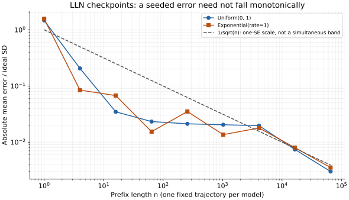
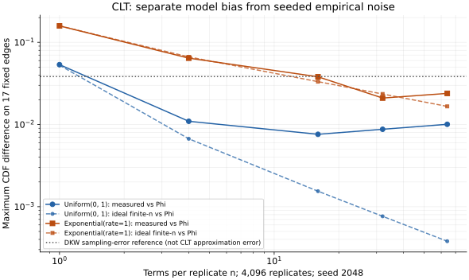

# Convergence teaching: one LLN path and independent CLT replicates

**Fact — task and scope.** This answers [#33](https://github.com/GredesCerber/matstat-lab/issues/33) using the versioned execution fixture from [#14](simulation-engine.md). The [study spike](../../spikes/convergence-teaching/) and this note add research evidence only; no application, kernel, protected configuration, decision register or shared plan is changed. The study was restored from an earlier unpublished attempt after the remote environment reset; its seeds, grids, models, repetitions and thresholds were preserved. Results were regenerated, not recovered as unverified old output.

**Assumption — proposed lesson.** Begin with rate-one Exponential observations, seed 2048. Show named successive prefixes of one trajectory for LLN, then independent replicate means standardized with the known model mean/variance for CLT. Retain Uniform(0,1) as a contrasting source. The defaults, questions and interpretation below are proposals for the owner, not an approved UI change.

## Facts and theory being illustrated

**Fact.** For iid observations with finite mean μ and positive finite variance σ², E(X̄_n)=μ and Var(X̄_n)=σ²/n. LLN concerns the concentration of means around μ; the classical iid CLT concerns the distribution of sqrt(n)(X̄_n−μ)/σ tending to N(0,1). Neither says each realized error decreases at every checkpoint. Finite variance is sufficient here, not necessary for every LLN. Source: [Yen-Chi Chen, UW STAT512 expectation and asymptotic notes](https://faculty.washington.edu/yenchic/20A_stat512/Lec3_Expectation.html).

**Fact.** The ideal Uniform(0,1) model has μ=1/2, σ²=1/12; Exponential(rate=1) has μ=1, σ²=1. The Exponential parameter here is a rate. Sources: [NIST Uniform](https://www.itl.nist.gov/div898/handbook/eda/section3/eda3662.htm), [NIST Exponential](https://www.itl.nist.gov/div898/handbook/apr/section1/apr161.htm). These ideal continuous laws are the mathematical references, while the execution sampler below uses a finite grid.

## Versioned draw order and the frozen plan

**Fact.** The unchanged [engine](../../spikes/simulation-engine/engine.mjs) declares `simulation-fixture-v1` and `fixture-mix32-v1`. One addressed uniform is `(fixtureUint32(seed,stream,index,namespace)+0.5)/2^32`. LLN uses stream 0 and namespace `0x51a7`, drawing index 0 through n−1. CLT uses stream j+1 for replicate j, namespace `0xc17`, and the same within-replicate order. Exponential values are `-Math.log1p(-u)`. Means are accumulated online in that order; chunk scheduling never changes their reduction order. Every case stores a SHA-256 of the complete canonical scientific payload, not just its final mean. Sources: engine; [runner](../../spikes/convergence-teaching/run.mjs); [recorded results](../../spikes/convergence-teaching/results.json).

**Fact — limitations of the fixture.** A fixed counter mixer and finite input grid are deterministic. They do not establish independent random observations or certify a production PRNG. In particular, Exponential output is bounded by 33 ln(2), unlike the ideal unbounded law. All probability-calibrated statements below are conditional ideal-iid-model diagnostics, subject also to numerical evaluation error, not unconditional coverage guarantees for this mixer. Source: [#14's grid/sampler and replay limitations](simulation-engine.md#numeric-and-resource-limits-in-this-fixture).

**Assumption — analysis plan.** The [machine-readable plan](../../spikes/convergence-teaching/plan.json) fixes the following settings before the current generation. This is a preserved fixed design from the earlier attempt, not an externally timestamped prospective preregistration. No seed, tolerance, endpoint or lesson n was adjusted to make a diagnostic pass. Failed/descriptive cases remain visible in the output.

| Setting | Fixed value |
|---|---|
| Models | Uniform(0,1), Exponential(rate=1) |
| Seeds | 0, 2048, 4294967295 (the #14 benchmark plus uint32 endpoints) |
| LLN prefixes | 1, 4, 16, 64, 256, 1024, 4096, 16384, 65536 |
| CLT terms per replicate | 1, 4, 16, 32, 64; n=32 retains the #14 benchmark |
| Independent-address CLT replicates R | 4096 for each model/seed/n case |
| Retained means | First 256 only; not used to estimate the full empirical CDF |
| Standardized histogram edges | −4 to 4 by 0.5: 17 edges, 16 bins, plus underflow/overflow |
| Replay budgets | 1, 7, 2048 draws per advance call |
| Local study error allocation | δ_family=0.001, 84 events, δ_event=0.001/84 |
| Default contrast | Exponential, seed2048, n=1 versus n=64 |

**Fact — family arithmetic.** There are 2×3×9=54 named LLN prefix events and 2×3×5=30 CLT cases. One whole-CDF DKW inequality bounds all grid comparisons of a given CLT case, so the 17 edges do not each consume a separate allocation. The 84-event union bound does not assume independence between prefix checks, between n values or between cases. The executed grid check is only a consequence of the whole-CDF inequality: passing the grid does not establish that the unobserved full supremum passes. Sources: plan, runner, [one-sample DKW statement with Massart constant 2](https://arxiv.org/abs/1107.5356) (introductory statement; none of that paper's two-sample thresholds are used).

**Assumption — separate policy scope.** The 84-event, .001 family is this bounded teaching study. It does not replace or get appended silently to [#32's proposed nine-case PR/nightly qualification family](qa-multiplicity.md), change its workload, or claim a .001 lifetime/global-suite error rate. Repeated new families, models or extra probabilistic assertions need a separately reviewed allocation. No retry-to-green, seed reroll or after-the-fact band widening is proposed.

## Predeclared bands and independent references

**Fact — LLN bands.** For ideal independent Uniform(0,1) observations, two-sided Hoeffding gives P(|X̄_n−1/2|>r_n)≤δ_event with `r_n=sqrt(log(2/δ_event)/(2n))`; clip the endpoints to [0,1]. It follows by applying the one-sided bound to X and 1−X and taking a union. Source: [Hoeffding1963, Theorem1, inequality(2.3), printed p15](https://www.cs.rpi.edu/academics/courses/spring06/random/hoefding.pdf#page=4), visually checked in the original. For ideal rate-one Exponentials, nX̄_n is Gamma(shape=n,scale=1), so the equal-tail band for X̄_n uses Gamma(shape=n,scale=1/n) quantiles at δ_event/2 and 1−δ_event/2. Source: [SciPy 1.17 Gamma documentation](https://docs.scipy.org/doc/scipy-1.17.0/reference/generated/scipy.stats.gamma.html), with the sum/scale calculation applied here.

**Fact — numeric evaluation.** [reference.py](../../spikes/convergence-teaching/reference.py) uses SciPy Gamma `ppf` for the lower endpoint and `isf` for the upper endpoint, independent of JavaScript samples. It computes the ideal finite-n standardized CDF by Irwin–Hall at `n/2+z sqrt(n/12)` for Uniform, and Gamma(shape=n,scale=1) at `n+z sqrt(n)` for Exponential (zero when that argument is nonpositive). Phi comes from `scipy.stats.norm.cdf`. Sources: [Irwin–Hall](https://docs.scipy.org/doc/scipy-1.17.0/reference/generated/scipy.stats.irwinhall.html), [Gamma](https://docs.scipy.org/doc/scipy-1.17.0/reference/generated/scipy.stats.gamma.html), [normal](https://docs.scipy.org/doc/scipy-1.17.0/reference/generated/scipy.stats.norm.html). The reference generator imports no project kernel or RNG and uses no simulated values.

**Fact — CLT sampling band.** DKW–Massart gives `P(sup_z |F_R(z)−F_n(z)|>epsilon)≤2 exp(−2R epsilon²)` for R iid replicate statistics with true finite-n CDF F_n. Here `δ_event=0.000011904761904761905` and `epsilon=sqrt(log(2/δ_event)/(2×4096))=0.038323827180794114`. Compare to the finite-n model to diagnose simulation; compare separately to Phi to illustrate the normal approximation. Applying the same epsilon to Phi is a predeclared descriptive compatibility flag, not an extra calibrated acceptance test or a claim that finite-n Exponential means are exactly normal. Source: [DKW primary paper's one-sample statement](https://arxiv.org/abs/1107.5356); reference generator.

**Fact — numeric precision boundary.** Gamma/Irwin–Hall/Phi evaluations and endpoint comparisons use binary64 library approximations, not certified interval arithmetic or exact real-number quantiles. The probability inequalities describe the ideal analytical bands; this implementation records their numerical evaluation. `--check` detects numerical/runtime drift and preserves the recorded evidence rather than silently changing it. Source: generator and its versioned [references.json](../../spikes/convergence-teaching/references.json).

## What is measured, including the tails

**Fact.** A CLT statistic is `Z=(replicateMean−μ)/sqrt(σ²/n)` with known model moments; it is not Studentized using the sample SD. All 4096 replicate means feed the histogram. `histogramCDF` counts z<−4 at the first edge, adds bins strictly below interior edges, and includes equality z=4 at the final edge, matching #14. It preserves underflow and overflow; the last cumulative count is R−overflow. For the continuous ideal CDF the left- and right-limit values coincide, so these fixed-edge comparisons inherit the DKW bound. Sources: engine, runner, `complete histogram conservation, CDF and retention invariance` test.

**Fact.** `gridDistanceToModel` and `gridDistanceToPhi` are maxima over these 17 edges. They are not full-sample KS statistics or full continuous-domain Kolmogorov suprema. The first 256 retained means cannot represent all 4096 observations and are not used for the distance. `finiteModelVsPhiBias` is also a grid maximum, now between the ideal finite-n CDF and Phi. Passing these tests is bounded evidence at the chosen settings, not a proof of CLT convergence, independence or correctness for all parameters. Sources: runner, plan and results.

## Observed outcomes

**Fact — regenerated evidence.** All 54 LLN prefix bands and all 30 finite-model CLT grid bands pass. All 36 complete scientific cases are byte-identical across the three replay budgets within the recorded runtime. Nine descriptive comparisons to Phi exceed epsilon: Uniform n=1 for all three seeds, and Exponential n=1 and n=4 for all three seeds. These normal-approximation misses are retained, not misreported as engine failures. Sources: results, fixture tests, independent references.

**Fact — one trajectory, seed2048.** Both columns below use the successive prefixes of one trajectory per model. The Exponential equal-tail band is asymmetric; these nine bands are jointly allocated as part of the 84-event family, not a confidence sequence for every n or an optional-stopping guarantee.

| n | Uniform mean (true 0.5) | Exponential mean (true 1) | Exponential ideal band |
|---:|---:|---:|---|
| 1 | 0.923090469 | 2.565125470 | [0.000005952, 12.031719258] |
| 4 | 0.440719109 | 0.915550738 | [0.027948440, 4.818936217] |
| 16 | 0.489998135 | 0.932581937 | [0.254028155, 2.491611122] |
| 64 | 0.493285143 | 0.984601602 | [0.543975494, 1.644646625] |
| 256 | 0.506125716 | 1.035095729 | [0.749576561, 1.297717204] |
| 1024 | 0.505894382 | 1.013604922 | [0.869016901, 1.142815173] |
| 4096 | 0.505676747 | 1.017878888 | [0.933046678, 1.069911880] |
| 16384 | 0.497854853 | 0.991991526 | [0.966155656, 1.034584018] |
| 65536 | 0.500866811 | 1.003530810 | [0.982985635, 1.017199286] |



**Fact — interpretation.** In the Exponential path the absolute error increases from n=64 to 256 and from 1024 to 4096. The plot's dashed 1/sqrt(n) is a one-standard-error scale, not one of the simultaneous bands or a pathwise upper bound. It normalizes each model's absolute error by its ideal SD to put the two sources on one scale. Source: selected results above and [figure generator](../../spikes/convergence-teaching/figures.py), which only reads frozen outputs.

**Fact — CLT, seed2048.** D_model is the empirical-to-ideal finite-n grid distance; D_Phi is empirical-to-normal; B_Phi is the ideal finite-n-to-normal grid bias. The sampling epsilon is 0.03832382718 for every row.

| Model | n | D_model | D_Phi | B_Phi | Phi within the descriptive epsilon? |
|---|---:|---:|---:|---:|---|
| uniform | 1 | 0.006398 | 0.053523 | 0.052670 | no |
| uniform | 4 | 0.017656 | 0.010950 | 0.006706 | yes |
| uniform | 16 | 0.008794 | 0.007605 | 0.001543 | yes |
| uniform | 32 | 0.009517 | 0.008753 | 0.000764 | yes |
| uniform | 64 | 0.009687 | 0.010066 | 0.000380 | yes |
| exponential | 1 | 0.010783 | 0.158655 | 0.158655 | no |
| exponential | 4 | 0.009995 | 0.064209 | 0.066530 | no |
| exponential | 16 | 0.014436 | 0.038086 | 0.033255 | yes |
| exponential | 32 | 0.004220 | 0.020996 | 0.023512 | yes |
| exponential | 64 | 0.008991 | 0.023926 | 0.016624 | yes |



**Fact — teaching observation.** For default Exponential seed2048, D_Phi decreases from 0.158655 at n=1 to 0.023926 at n=64, while increasing from 0.020996 at n=32 to 0.023926 at n=64. The ideal finite-n bias decreases on this grid, but empirical noise can reverse adjacent observed distances. Thus neither per-seed distances nor a path's errors should be animated or asserted as necessarily monotone. Source: frozen results; the default fixture test asserts only the preselected endpoint contrast n=1 versus 64.

## Applicability and failed assumptions

| Source-backed fact or derived fact | Consequence for the lesson |
|---|---|
| Standard Cauchy has undefined mean and SD ([NIST](https://www.itl.nist.gov/div898/handbook/eda/section3/eda3663.htm)). | Do not center at a supposed mean0 or divide by a supposed finite sigma. It is an analytical counterexample here, not a simulated case of this spike. |
| For Pareto(shape1.5,scale1), integrating the [density1.5/x^2.5 on x≥1](https://docs.scipy.org/doc/scipy-1.17.0/reference/generated/scipy.stats.pareto.html) gives mean3 and infinite second moment. | iid finite-mean LLN can apply, while the classical finite-variance normal CLT and sigma/sqrt(n) normalization used here do not. No Pareto simulation is claimed. |
| Finite-n Exponential means are skewed Gamma variables (reference.py and Gamma model). | Small n=1,4 visibly miss the normal overlay even when finite-model diagnostics pass. A pass at n=16 does not certify normality or a universal adequate n. |
| If every X_i is the same nondegenerate X, X̄_n=X and its variance does not shrink (direct substitution). | Finite variance alone is insufficient when independence fails; distinct addressed streams are a fixture construction, not a proof that the mixer produces iid values. |
| If sigma²=0, standardization divides by zero (the definition of Z). | A constant-law demonstration needs separate semantics; it is outside these two positive-variance models. |

## Default lesson proposal

**Assumption — before running.** Ask: “If we take more observations, must the next mean be closer?” Use Exponential(rate1), seed2048, and the nine named prefixes. Keep earlier points so students can identify at least one error increase without changing the seed. Ask them to distinguish a statement about convergence in probability from this particular trajectory.

**Assumption — repeated sampling.** Keep the source and seed fixed; show 4096 independent-address replicate means first for n=1, then4,16,32,64. Label n as terms per mean and R as the number of replicate means. Keep the standardized horizontal scale fixed. Put the ideal finite-n curve beside the normal overlay, and present both D_model and D_Phi with the sampling-error reference. Do not substitute a histogram of one trajectory's overlapping prefixes for this sampling distribution.

**Assumption — contrast and checks.** Switch only the source to Uniform(0,1) with the same n grid and seed to compare skewed and symmetric sources. Suggested class checks: (1) Why can the LLN error grow between named checkpoints? Answer: convergence does not impose a monotone path. (2) Why can a correct Exponential simulation disagree with N(0,1) at n=1? Answer: the true finite-n law is not normal. (3) Why does increasing R differ from increasing n? Answer: R reduces empirical estimation noise for a fixed finite-n sampling law; n changes that law and its approximation to normal.

**Assumption — integration boundary.** These settings are for #14's U(0,1)/Exp(1) execution fixture. Current application kernels may use centered Uniform models, other draw namespaces, other defaults or other stream conventions. The same integer seed is not a cross-generator equivalence contract. An assigned integration task must preserve model parameters and seed/RNG versions and review differences; this research does not change the UI's running controls or approved global policy.

## Reproducibility, tests and remaining limits

**Fact.** The results record Node 24.22.3 / V8 13.6.233.17-node.63, Python 3.12.14, NumPy 2.3.5 and SciPy 1.17.0, plus hashes of plan, reference, both generators and engine. Figures were rendered with Matplotlib 3.10.8; they contain no new samples or tuned parameters. Runtime/source changes can alter last bits or library evaluations, so exact regeneration is promised only for matching recorded inputs/runtime, not across platforms. Source: results provenance and generators.

**Fact.** Eighteen tests pass: seven new study tests and eleven existing #14 engine/Worker/lifecycle tests. They cover stream/prefix identity, independent replicate addressing, exact full-payload replay, complete histogram mass/CDF and retain0/256 invariance, invalid versions/missing or altered references, exact oracle/result regeneration, the predeclared endpoint contrast, and published #14 benchmarks. The n=32 histograms match the original integer counters exactly; LLN prefixes and CLT summary means/variances match the older recorded runtime within the inherited comparator `abs(a−b)≤1e−12+1e−12 max(abs(a),abs(b))`. This is observed replay compatibility, not a universal approximation-error bound. Sources: [fixture tests](../../spikes/convergence-teaching/fixtures.test.mjs), original [node-evidence.json](assets/simulation-engine/node-evidence.json).

**Fact — reproduction from the root.** Test failures were observed before restoration of the missing implementation; the unchanged design was then regenerated. The earlier unpublished work had been interrupted by an environment reset. Its total active time across the lost session cannot be reconstructed reliably; the current recovery does not establish a fresh prospective preregistration or a cross-platform byte-identity promise.

```sh
python3 spikes/convergence-teaching/reference.py --check
node spikes/convergence-teaching/run.mjs --check
node --test spikes/convergence-teaching/fixtures.test.mjs spikes/simulation-engine/engine.test.mjs spikes/simulation-engine/worker.test.mjs spikes/simulation-engine/scheduler.test.mjs spikes/simulation-engine/boundary.test.mjs
python3 spikes/convergence-teaching/figures.py
CREW_AGENT=codex crew check
```

**Fact — verification boundary.** The repository's full root `crew check` is configured for absent web/api/acceptance targets and has been reporting `verified:false` with every step skipped; [#144](https://github.com/GredesCerber/matstat-lab/issues/144) tracks the missing relevant checks. The study's executed scientific tests are reported separately. No product/browser test or complete successful harness verification is claimed, and protected configuration is unchanged. This research is submitted as a draft while that verification gap and independent review remain pending.

| #33 acceptance criterion | Concrete evidence |
|---|---|
| One versioned LLN trajectory, successive named prefixes and predeclared bands | 6 cases, 54 prefix records with numerical band endpoints, complete payload hashes, stream0 addressing and chunk replay tests. |
| Independent-address CLT replicates, normal comparison with predeclared band, failed assumptions/slow cases | 30 cases, finite-n/Phi CDF arrays and grid distances, fixed epsilon, nine retained descriptive normal misses; Cauchy/Pareto/dependence/zero-variance limitations named. |
| Named default models, parameters, n, seeds and expected pattern | Exp(rate1), seed2048, nine LLN checkpoints, CLT n1,4,16,32,64 and R4096; Uniform0,1 contrast; fixed numerical tables and both figures. |

## Position

**Assumption — proposal.** Use these pinned fixtures as reviewable teaching checkpoints. Keep one-path LLN and independent-replicate CLT separate, distinguish finite-model correctness from normal-approximation quality, preserve all histogram tail mass, and keep the observed nonmonotonic cases visible. Retain the normal misses rather than tuning them away. Production RNG qualification, global release-family allocation, optional-stopping/confidence-sequence behavior and any full-supremum KS check remain separate reviewed decisions. The .001 allocation here is a conditional ideal-model teaching diagnostic, not certification of the deterministic mixer or an approval to change CI.
