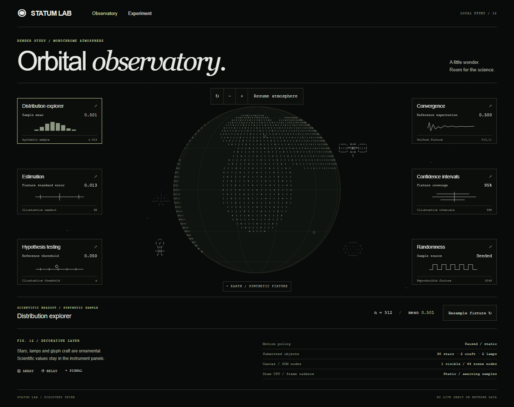
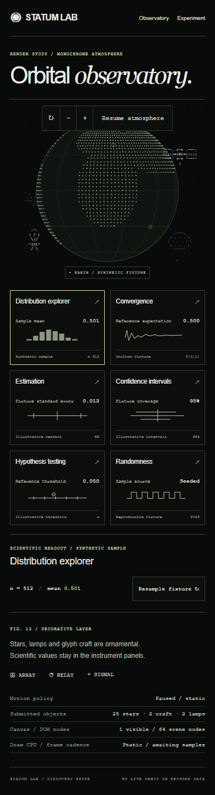

# Orbital atmosphere: transparent glyphs, separate motion, protected instruments

**Fact — scope:** this answers [issue #12](https://github.com/punyzxc/matstat-lab/issues/12), a Discovery study assigned to @Jumalinova. The deliverable is this document, an isolated [compositing spike](../../spikes/orbital-atmosphere/), and desktop/mobile evidence. This is a proposal, not an agreed team decision or product implementation.

## Findings from primary sources

- **Fact:** `requestAnimationFrame` schedules one callback; continued animation requires another request. Its timestamp supports time-based animation across refresh rates. [MDN: requestAnimationFrame](https://developer.mozilla.org/en-US/docs/Web/API/Window/requestAnimationFrame).
- **Fact:** the Page Visibility API provides `visibilitychange` and document visibility state; browsers may throttle background work. [MDN: Page Visibility](https://developer.mozilla.org/en-US/docs/Web/API/Page_Visibility_API).
- **Fact:** a `MediaQueryList` exposes its current match and a change event, so a running page can react to preference changes. [MDN: MediaQueryList](https://developer.mozilla.org/en-US/docs/Web/API/MediaQueryList).
- **Fact:** W3C's explanation of SC 2.2.2 describes user control over qualifying automatically moving content presented alongside other information. This study supplies a pause button; it does not claim a complete WCAG audit. [W3C: Pause, Stop, Hide](https://www.w3.org/WAI/WCAG22/Understanding/pause-stop-hide).
- **Fact:** `pointer-events: none` removes the canvas itself from pointer targeting; `aria-hidden` removes decorative content from the accessibility tree. Neither is permission to hide interactive controls or meaningful scientific results. [MDN: pointer-events](https://developer.mozilla.org/en-US/docs/Web/CSS/Reference/Properties/pointer-events), [MDN: aria-hidden](https://developer.mozilla.org/en-US/docs/Web/Accessibility/ARIA/Reference/Attributes/aria-hidden).

## What the spike demonstrates

**Fact — observed in the [source](../../spikes/orbital-atmosphere/study.mjs) and [automated evidence](assets/orbital-atmosphere/browser-evidence.json):** one visible Canvas2D surface draws seeded stars, sample ASCII motifs, ARRAY and RELAY craft, and two gently pulsing lamps. Real DOM links, buttons and scientific readouts sit above it. The cached globe is a synthetic drawing made from ellipse-based land patches, not a geographic dataset. Other instrument values are labeled as fixtures; resampling computes the mean of 512 seeded uniform values independently of decoration.

**Fact — draw order in this experiment:**

1. Clear the decorative canvas and draw seeded stars.
2. Draw the sample SIGNAL/CAPSULE motifs and visible rear-depth craft.
3. Composite the cached, opaque globe surface as the physical occluder.
4. Draw visible front-depth craft and low-amplitude beacon pulses.
5. Leave the DOM instruments and controls above all decorative painting.

**Fact — transparent sprites:** the [glyph renderer](../../spikes/orbital-atmosphere/model.mjs) uses text rows, without a rectangle, highlight, shadow panel or backdrop behind a satellite. A recording-context test fails if sprite drawing invokes a fill/clear rectangle or filled path. This tests an alternative to the backed glyph treatment in the [reference prototype](https://github.com/punyzxc/matstat-lab/blob/9e2c19bfacdef4d303114dff7ca8258cbe5e1d1f/spikes/visual-foundation/src/orbital-atmosphere.ts).

**Fact — controls stay independent:** the canvas is decorative and cannot receive pointer events. All six instrument links, keyboard resampling, globe rotation and globe zoom remain operable while decorative time is stopped. The scientific sample generator uses a separate PRNG instance. [Browser checker](../../spikes/orbital-atmosphere/browser-check.mjs).

**Fact — motion lifecycle:** pause, a matching reduced-motion preference, or hidden-document state cancels the pending animation request. Unhiding resets the prior timestamp instead of advancing through hidden time. A manual control can request a static redraw without restarting the loop. The normal loop submits drawing at a target ceiling of 30 fps; it is not a promise of 30 rendered frames on every device. [Lifecycle source and unit checks](../../spikes/orbital-atmosphere/atmosphere.test.mjs).

**Fact — appearance treatment:** sample beacons pulse continuously with a four-second period instead of switching abruptly. The synthetic fixture producer applies a 400 ms opacity envelope next to its declared visibility transitions; invisible snapshots are not drawn. A false visibility flag always wins over opacity. [Fixtures](../../spikes/orbital-atmosphere/fixtures.mjs).

## Boundary with #11 and #5

**Fact — ownership:** [#11](https://github.com/punyzxc/matstat-lab/issues/11) owns orbital projection and collision rules; [#5](https://github.com/punyzxc/matstat-lab/issues/5) owns the final art catalog. This spike uses invented screen-space keyframes and original sample glyphs. It does not calculate orbital elements, displace another owner's coordinates, create a shared contract, or edit the integrated prototype in [PR #9](https://github.com/punyzxc/matstat-lab/pull/9).

**Assumption — suggested renderer input for later coordination, not an approved contract:**

```ts
type ProjectedDecor = {
  id: string;
  kind: 'array' | 'relay';
  x: number; y: number; // CSS pixels relative to the decorative canvas
  depth: number;       // negative = before globe; nonnegative = after globe
  visible: boolean;    // supplied by the projection owner, never inferred from alpha
  opacity?: number;   // optional appearance envelope, clamped to [0, 1]
};
type ReservedRect = { x: number; y: number; width: number; height: number };
```

**Fact — conservative renderer safety:** the study reads the actual DOM panel/control/label bounds, expands them by 8 CSS px, and omits a decorative object if its full drawing bounds intersect a reserved rectangle. It omits instead of moving the object. This is a local visibility safeguard for the synthetic fixtures, not the team's production collision policy. Resizing recomputes the bounds. [Compositing model](../../spikes/orbital-atmosphere/model.mjs).

**Assumption — limitation:** conservative omission can create disappearance at a panel boundary. The final projection owner should supply intentional travel corridors or a coordinated visibility envelope; this study must not be used to claim collision-free physical orbits. Partial limb occlusion is only demonstrated by drawing rear layers beneath the globe; the external visibility flag remains authoritative.

## Desktop and mobile evidence

**Fact — capture method:** both study variants use seed 2048, fixture time 6 s and an explicitly paused state. The baseline turns off the atmosphere with `baseline=1` while retaining the same globe and DOM instruments. These are control/treatment comparisons; there was no runnable scene on the task's base `main`, so they are not screenshots of a previously shipped version. Evidence is stored in `docs/`, within the Discovery phase's allowed paths.

| Viewport | Baseline: atmosphere off | Treatment: atmosphere on |
|---|---|---|
| 1440 × 1000 | [Desktop baseline](assets/orbital-atmosphere/desktop-baseline.png) | [Desktop atmosphere](assets/orbital-atmosphere/desktop-atmosphere.png) |
| 390 × 844 | [Mobile baseline](assets/orbital-atmosphere/mobile-baseline.png) | [Mobile atmosphere](assets/orbital-atmosphere/mobile-atmosphere.png) |





**Fact — automated checks:** both widths passed all six route hit-target checks, keyboard resampling while paused, manual globe rotation, live reduced-motion changes, and a simulated document-visibility transition. No horizontal overflow, external requests, page errors or per-frame DOM growth were observed. A sweep of 65 synthetic snapshots over the 32-second fixture cycle examined 6,728 desktop and 1,974 mobile decorative bounds without an intersection with a reserved UI rectangle. [Raw evidence](assets/orbital-atmosphere/browser-evidence.json).

## Representative performance session

**Fact — observed measurement:** one headless Chrome 157.0.8103.79 session on Windows, captured 2026-11-23 at 09:37:55 UTC, profiled six seconds at each viewport with DPR 1. The globe pose and zoom were restored after the interaction checks. These are desktop-browser viewport studies, not measurements from physical mobile hardware. [Raw session](assets/orbital-atmosphere/browser-evidence.json).

| Measurement | 1440 px viewport | 390 px viewport |
|---|---:|---:|
| Canvas CSS size | 1344 × 600 | 354 × 787 |
| Seeded stars generated / submitted after UI culling | 144 / 98 | 72 / 25 |
| Submitted craft / motifs / beacons at capture | 2 / 2 / 2 | 2 / 2 / 2 |
| Visible canvas elements / scene descendant DOM nodes | 1 / 64 | 1 / 64 |
| Canvas drawing primitives in final sampled frame | 123 | 50 |
| Warm drawing samples | 174 | 179 |
| Drawing CPU: median / p95 / max | 0.60 / 1.30 / 2.30 ms | 0.40 / 1.10 / 2.20 ms |
| Draw cadence: median / p95 | 33.40 / 49.20 ms | 33.40 / 47.20 ms |

**Fact — interpretation limits:** a primitive is a Canvas2D fill/stroke/text/drawImage/clear invocation, not a GPU draw call. Submitted star counts include stars subsequently covered by the globe. Drawing CPU measures the JavaScript/canvas portion of the warm `drawFrame`, before telemetry DOM updates; it excludes cold globe-cache construction, compositing, GPU execution and display latency. Cadence measures spacing between observed draws and includes scheduling/automation effects. The p95 cadence exceeded the nominal 33.3 ms target, so this is evidence of a bounded inexpensive warm renderer, not a stable-frame-rate guarantee.

**Assumption — next validation:** test the approved assets with #11's real trajectories, DPR 2 and physical lower-end phones, projector contrast, a screen reader and actual background-tab/BFCache behavior. The hidden-state browser check dispatches a synthetic visibility event; the unit test separately proves callback cancellation. No full accessibility or flash-threshold conformance is claimed.

## Reproduce and acceptance coverage

**Fact — commands:** [README](../../spikes/orbital-atmosphere/README.md) documents the dependency-free server and installed-Playwright browser checker. No new package or browser installation was required on this workstation.

```sh
node spikes/orbital-atmosphere/serve.mjs
node --test spikes/orbital-atmosphere/atmosphere.test.mjs
node spikes/orbital-atmosphere/browser-check.mjs
crew check
```

**Fact — test-first evidence:** the first task commit, `914b333`, contains the four initially failing model/lifecycle tests. Research-specific tests live inside the permitted spike, because Discovery's phase gate forbids adding files under `tests/acceptance/`; the common production check preset does not discover them. `crew check` is still required separately, and its skipped production steps must not be reported as tested product behavior.

| Criterion | Fact: evidence |
|---|---|
| Distinct neutral ASCII, seeded stars, pulsing beacons, two craft, no filled masking highlight | Glyph/seed unit tests; both treatment captures; Canvas source |
| Pause/reduced-motion/hidden state stop decoration; instruments stay usable | Cancelable-loop unit test; both viewport browser checks for live media change, simulated visibility, six links, keyboard resample and manual globe controls |
| 390 / 1440 px, sample trajectories, no obstructed targets/labels, object/DOM/primitive counts and frame timing | Full-page captures; 65-snapshot clearance sweeps per viewport; raw measured session and table above |

## Position

**Assumption — recommendation:** keep decorative painting on one transparent, noninteractive canvas with an independently cancelable clock, cache the globe surface, draw glyph craft without backing panels, and leave all navigation/scientific values in accessible DOM. Accept the conservative reserved-rectangle safeguard as a renderer experiment while #11 evaluates the actual geometry policy.

**Assumption — unresolved:** the final glyph assets, acceptable ornament contrast on projectors, real trajectory visibility semantics and physical-mobile performance need cross-area validation. The proposal does not settle those decisions and must not be moved into product code before the team approves its plan.
