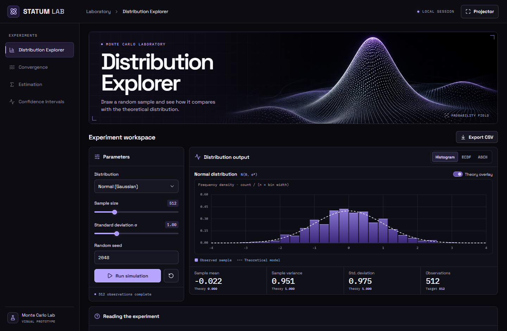

# Distribution Explorer visual foundation

## Evidence

The desktop and narrow workspace present a near-black app shell, with a compact instrument sidebar and a violet accent for controls and observed data. The entry scene uses an original ImageGen particle-lattice probability surface as atmosphere. The Histogram, ECDF and ASCII views use the same seeded observations. Dashed white marks represent theory and lavender bars or a solid line represent the sample. The numeric bin table and raw CSV make the output accessible without inspecting pixels or treating glyphs as raw values.

The first run supports Normal, Uniform and Exponential. Run, Pause, Resume and Reset preserve the selected run's provenance. During the reveal, histogram bars normalize against the target sample size to preserve the axis and document the incomplete mass. The ECDF uses the visible observations and varies with sample size. Values outside a plot's visible domain stay in the moments and export and are reported in the legend.

The implementation follows the component structure documented by shadcn and uses Radix for keyboard tabs. Motion and CSS provide a short entrance and panel reveal. Reduced motion gives an immediate completed sample. A visible focus ring, keyboard navigation, labeled controls and a data table are verified behaviors. The 390 px view has no document overflow.

Four local tests covered the seed sequence, histogram normalization, variance and model functions. Three Playwright tests covered keyboard tab navigation and repeatability, model changes and CSV on a narrow screen, and preserving a paused partial run before completion. The TypeScript/Vite build passed.

## Position

Use the shell and visual rules as the reference for the approved build. Keep the plot and ASCII view tied to a shared data snapshot, with data controls always reachable and visual ambience confined to the entry scene. Compare bounded worker throughput, exact cross-runtime reproducibility and accessible chart semantics during the remaining Discovery work. Create the supported production math core and chart implementation under the approved contracts.

[Prototype run instructions](../../spikes/visual-foundation/README.md) · [Radix Tabs](https://www.radix-ui.com/primitives/docs/components/tabs) · [Motion accessibility](https://motion.dev/docs/react-accessibility) · [Scientific visualization](https://github.com/K-Dense-AI/scientific-agent-skills/tree/main/skills/scientific-visualization)

