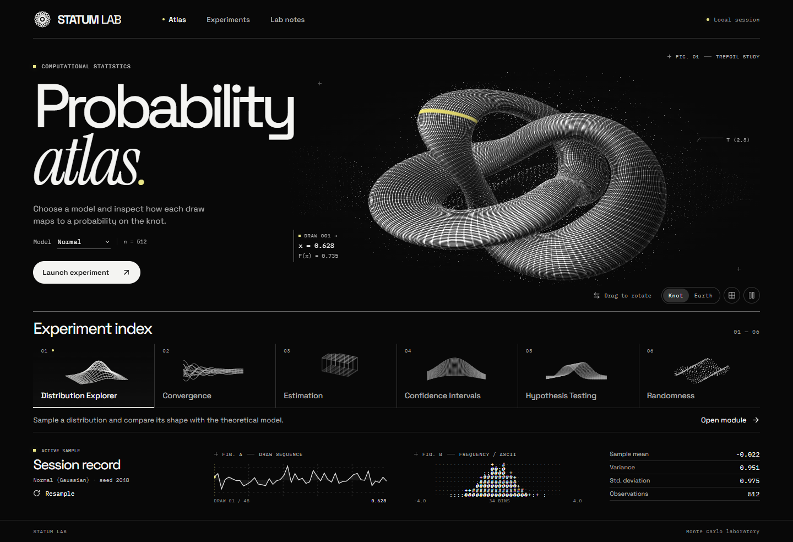

# Probability Atlas

## Discovery result

The prototype opens on a working Monte Carlo sample. Changing the model immediately regenerates the sample with the same seed. Selecting the draw readout advances to the next observation. Its yellow cross-section follows the model CDF along a parametric trefoil. The ring parameter is a probability in [0, 1]. Distance along the curve has no statistical units. Dragging and arrow keys turn the specimen. The second specimen is an orthographic Earth with simulated links.

The session record draws its trace, 34-bin ASCII histogram and sample statistics from the active sample. Resample advances the seed by one. Distribution Explorer provides parameter editing, pause, resume, reset, a histogram, an ECDF, ASCII output, underlying bin counts and a raw CSV. The five method previews compute results on a user-selected prefix. Reset and replay were checked against numerical fixtures.

[Motion study](assets/probability-atlas-motion.webm) · [Mobile](assets/probability-atlas-mobile.png) · [Distribution Explorer](assets/probability-atlas-experiment.png) · [ASCII experiment output](assets/probability-atlas-ascii.png)

## Design specification for this prototype

- **Composition.** One free-standing specimen occupies the larger half of a double-page spread. The model control and launch action sit next to it. The experiment index uses six engraved thumbnails. The working record follows under one horizontal rule. On a narrow screen the specimen follows the controls and the index uses two columns.
- **Type and colour.** Space Grotesk carries controls and titles, Instrument Serif italic names the atlas, and IBM Plex Mono sets measurements. Neutral black, white and grey define the surface. Pale yellow marks the probability coordinate, selected signals, keyboard focus and the dashed theory series. The empirical series uses solid marks.
- **Motion.** A shared drawing loop controls both specimens, holds the last frame while paused, stops outside the viewport and observes changes to reduced motion. Pointer and keyboard rotation remain available on a stationary frame. Pixel density and frame cadence are bounded. The GPU uploads geometry once per mount and releases buffers on exit. A Canvas 2D engraving takes over if WebGL is unavailable or the context is lost.
- **Extension.** The registry supplies module IDs and navigation. Each study supplies a thumbnail and a numerical readout. Shell, captions, type and colour tokens, scene controls, and rendering lifecycle are shared. The numerical core stays independent of the renderer.
- **Scientific encoding.** The current model supplies the CDF. Frequency density uses count divided by sample size and bin width. During progressive reveal the histogram uses the target count and labels this explicitly. The ECDF uses the observations drawn so far. Out-of-range observations remain in the statistics and CSV.

## Rendered review

The first engraving used circular cross-sections and evenly weighted ribs. The second introduced woven filaments, a particle sheath and the CDF marker. The third flattened and twisted the tube cross-section, changed the lighting and improved clearance above and below the object. Narrow-screen review exposed an overflowing title at 320 px. Its type scale now fits the viewport. The mobile and desktop captures show the final arrangement.

The TypeScript/Vite build, six numerical tests and eleven Chrome browser tests passed locally. The tests exercised replay, export, module routes, keyboard control, pause, reduced motion, model selection, the probability probe and the 2D fallback. Manual browser automation also forced a live WebGL context loss and verified recovery on a new canvas. Layout checks covered widths of 320, 360, 390, 768, 1024 and 1440 pixels. Projector mode has browser coverage. Physical projection remains a field check.

The geographic renderer uses longitude crossings derived from the Natural Earth land polygons at a latitude interval of 0.9 degrees. The trefoil, particle field and six index engravings are generated in code. [Natural Earth land source at the pinned revision](https://github.com/nvkelso/natural-earth-vector/blob/ca96624a56bd078437bca8184e78163e5039ad19/geojson/ne_110m_land.geojson)

## Position

Adopt the atlas as the candidate design for captain and independent review. The sample controls, probability coordinate and shared run demonstrate the primary teaching interaction. Performance on classroom hardware and the broader Discovery questions remain open. [Run the prototype](../../spikes/visual-foundation/README.md) · [Reference set and PRD draft](https://github.com/punyzxc/matstat-lab/pull/8)
