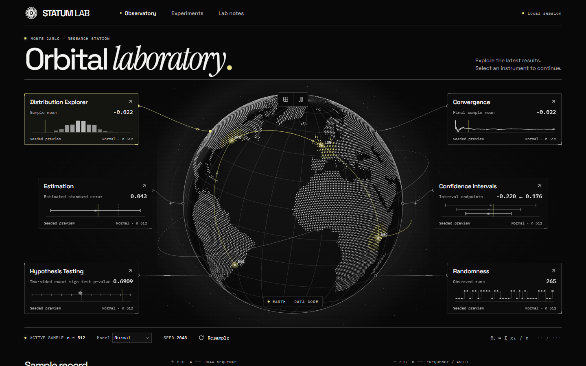

# Orbital Laboratory

[Motion recording](assets/orbital-laboratory-motion.webm) · [Mobile](assets/orbital-laboratory-mobile.png) · [Reference set and design specification](https://github.com/punyzxc/matstat-lab/pull/8)

## Discovery result

The Earth point cloud anchors six experiment links. Each trajectory begins on the visible globe rim and ends at the measured edge of a module window. Keyboard focus and pointer hover highlight the corresponding path. The last opened module provides the resting focus of the scene. Mobile layouts keep the globe at the top and route the connections down a shared spine. Geographic arcs on the globe illustrate simulated station links.

A window opens its experiment directly and shows a result based on the settings and sample prefix associated with that module. The six charts use histogram counts, running mean, estimate and standard error, nested Chebyshev intervals, observed sign share and its exact test probability, and signs in draw order. Gray geometry encodes the data. A yellow signal marks focus or the scan position. The final value and provenance remain available throughout any visual interpolation.

The browser stores a versioned entry per module and records the last opened module independently. A result consists of its distribution, scale, seed, sample size and analyzed prefix. The deterministic sampler replays that result. If storage is unavailable, the session works in memory. If no valid entry exists for a module, the window labels its current sample as a seeded preview. Drafts, partial reveals and paused runs preserve the previous Distribution Explorer result.

## Extension and motion

- Register module metadata, render its window through the common link, and provide its numerical preview mapping. The layout and diagram share measured anchors.
- Use the common pause and reduced-motion state for the globe, link pulses, chart sweeps and numeric interpolation. The globe caps pixel density and reduces redraw cadence on slower devices. The diagram suspends outside the viewport. Manual globe rotation works while paused.
- Retain the trace and ASCII bins beneath the stage. Distribution Explorer still has ECDF, exact bin counts, reset and CSV. The secondary trefoil retains its CDF probe and Canvas fallback.

## Verification and next decision

The TypeScript/Vite build, six numerical tests and twelve browser tests passed locally. The browser cases cover six direct routes, snapshot validation, persistence after reload, last-opened state, pause, live reduced-motion changes and fallback behavior. Rendered layouts were measured from 320 to 1440 pixels. Frame cadence on classroom hardware and physical projection remain field checks.

The design discussion covers the six parallel research tracks in [PR #8](https://github.com/punyzxc/matstat-lab/pull/8). Incorporate the approved composition and storage contract into the reviewed PRD before starting the production build. [Prototype instructions](../../spikes/visual-foundation/README.md)
